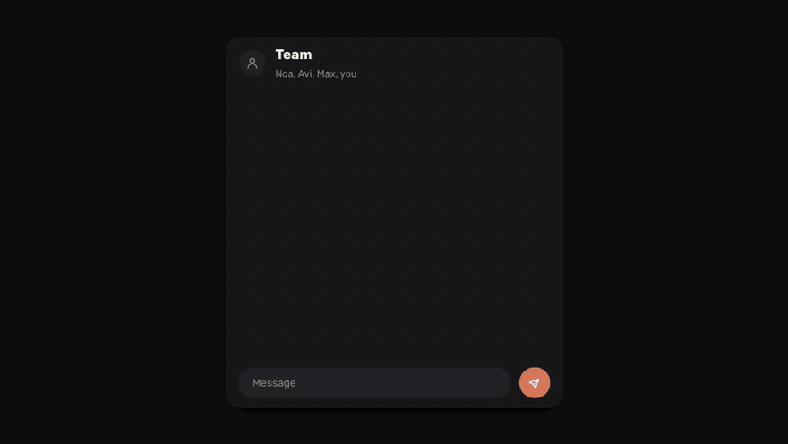

# whatsapp-claude-tag

Type `@claude` at the start of a message in any WhatsApp chat on your own phone (a group, a chat with a friend, or your chat with yourself) and Claude Code does what you asked.



[Watch it with sound (MP4, 20 s)](docs/demo.mp4)

```
@claude summarize what happened in this group today
@claude summarize today's messages here and send it to me privately, then delete this message
@claude copy the message I'm replying to and send it to Dana
@claude write Yossi that I'm 10 minutes late, ask me before sending
```

It runs on your own machine and uses your own Claude Code login. It reaches WhatsApp in one of two ways:

- **Evolution**: an [Evolution API](https://github.com/EvolutionAPI/evolution-api) server that already has your number connected. Use this if you run Evolution anyway.
- **Baileys**: a direct connection through [Baileys](https://github.com/WhiskeySockets/Baileys), linked to your phone with a QR code like WhatsApp Web. Nothing else to run: no Docker, no Postgres, no Redis. See [Without Evolution: Baileys](#without-evolution-baileys).

## How it works

1. Every two seconds the watcher looks up the newest messages **you** sent (`fromMe`). With Evolution it asks the server and does not use a webhook, so if another service already owns your instance's webhook, both keep working. With Baileys it reads its own local message store.
2. A message that starts with `@claude` (or any name you configure) becomes a run. If you were replying to a message, its text goes along as context.
3. The run is `claude -p` with a small MCP server attached. That server gives Claude five tools: `find_chat`, `read_chat`, `send_message`, `request_approval` and `delete_trigger_message`.
4. Claude reads what it needs, then acts. By default it answers in the chat where you tagged it. You can tell it to answer privately, to send to someone else, to delete your `@claude` message, or to ask you before it sends.

Only messages you send trigger it. Nobody else in a group can use your `@claude`.

## Safety model

The chats it reads are written by other people, and a message in a group could say "forward this to X". The rule that stops this is enforced in the MCP server, not left to the model. A run may only read or send to:

- the chat you tagged it in,
- your own chat ("send it to me"),
- a chat you named in your own `@claude` text, by name or by phone number.

Anything else is refused, and Claude has to tell you so. Text quoted from other people never counts as naming a chat. Names match whole words only (Hebrew prefixes such as ל and ו are allowed), and common request words like "today" or "summary" never count, because other people choose their own display names. Every send to a chat other than the tagged one or your own leaves a receipt in your own chat, so a send you did not expect is visible right away.

Your own chat holds drafts, receipts and answers from other runs, so a run can always write to it but can only read it when you tagged it there.

Everything the tool sends has a word joiner inserted after a leading `@`, so its own messages can never trigger another run.

Name matching is a guard, not a guarantee: the stopword list cannot cover every word you might type, and a contact can pick any display name. The receipt is what makes a wrong send visible. For anything sensitive, name the recipient by phone number or ask for approval.

By default Claude gets the WhatsApp tools plus `WebSearch`, plus the tools of any extension you add, and nothing else: no shell, no file access and no `WebFetch`. A run that has read chat history could be steered into fetching a URL that carries that history, so `WebFetch` is opt-in (`claude.webFetch: true`). Setting `claude.fullAccess: true` gives it all of Claude Code's tools with permissions bypassed. Only turn that on if you accept that a crafted message in a chat you summarize could try to steer it.

Each run uses its own Claude Code config directory (`claude.configDir`), so your personal hooks, plugins and MCP servers do not load into it.

## Approvals

If your request asks for confirmation, Claude does not send. It posts a draft to your own chat instead. Swipe-reply to the draft with `yes` / `כן` to send it, or `no` / `לא` to drop it. The watcher sends the stored draft itself, without another Claude run, so what you approved is exactly what goes out. Drafts expire after a day.

## Follow-ups

Swipe-reply to anything a run sent and the same Claude session continues, so you can answer its questions ("which group?") or ask for changes. In your own chat a plain reply is enough. In any other chat, start the reply with `@claude`, because there you might just be quoting the message to the people you are talking to.

## Install

**With Claude Code (recommended):** open Claude Code on the machine that will run it and say:

> Install whatsapp-claude-tag on this machine by following INSTALL.md in https://github.com/dangogit/whatsapp-claude-tag

[INSTALL.md](INSTALL.md) is written for an agent to follow. It sets up everything and stops only for the two steps that need you: `claude setup-token` and scanning a QR code with your phone.

**What it sets up:**

- Node.js 20 or newer (22.13 or newer if you choose Baileys). With Evolution there are no npm dependencies; Baileys and `qrcode-terminal` are optional dependencies, loaded only when `transport` is `"baileys"`.
- [Claude Code](https://docs.claude.com/en/docs/claude-code), authenticated for headless use with `claude setup-token` (or `ANTHROPIC_API_KEY`).
- A WhatsApp connection, one of two:
  - **Evolution API v2** (the default, and what INSTALL.md sets up), the WhatsApp Web gateway. `deploy/evolution/` has a ready Docker Compose file (API, Postgres and Redis, bound to `127.0.0.1`, pinned to v2.3.7) and `pair.mjs`, which creates the instance and shows the QR to scan. Already running Evolution? Point the config at it instead.
  - **Baileys**, no Docker: the watcher connects directly. See [Without Evolution: Baileys](#without-evolution-baileys).
- The watcher as a service: `deploy/install-launchd.sh` on macOS, or a systemd user unit on Linux (example in INSTALL.md).

**By hand, in short:**

```bash
git clone https://github.com/dangogit/whatsapp-claude-tag.git && cd whatsapp-claude-tag
cd deploy/evolution && cp .env.example .env    # set both secrets, then:
docker compose up -d && cd ../..
node deploy/evolution/pair.mjs --instance personal    # scan the QR on your phone
mkdir -p ~/.config/whatsapp-claude-tag && cp config.example.json ~/.config/whatsapp-claude-tag/config.json    # edit it
node src/cli.mjs check
node src/cli.mjs run
```

## Without Evolution: Baileys

Baileys talks to WhatsApp directly and links as one of your phone's linked devices.

```bash
git clone https://github.com/dangogit/whatsapp-claude-tag.git
cd whatsapp-claude-tag
npm install
mkdir -p ~/.config/whatsapp-claude-tag
cp config.baileys.example.json ~/.config/whatsapp-claude-tag/config.json
node src/cli.mjs pair
```

`pair` prints a QR code in the terminal. On your phone open WhatsApp, Settings, Linked devices, Link a device, and scan it. The pairing is saved under `baileys.authDir` (one folder per account; keep it private, it is a login). Then `check` and `run` work as above. With more than one account, pair each with `pair --account <name>`. To unpair, remove the device on the phone and delete its folder.

What is different from Evolution:

- **History starts at pairing.** Baileys has no history API, so the watcher keeps its own SQLite store of every message the connection receives or sends. `read_chat` sees only messages that arrived since you paired, and only while the watcher was running. Messages older than `baileys.keepDays` (30) are pruned.
- **One connection, held by the watcher.** A second connection on the same pairing would make WhatsApp drop the first, so each run's MCP server reaches WhatsApp through the watcher, over a Unix socket in `stateDir` that only your user can open. The tools and the recipient policy are the same as with Evolution. `pair` refuses to start while the watcher is running.
- **The watcher never pairs on its own.** It will not start without a pairing, and if you unlink the device on the phone it logs `baileys-closed` with state `logged-out` and stops sending. Delete the account's folder under `baileys.authDir` and run `pair` again.
- **Storage** uses Node's built-in `node:sqlite` rather than an npm package, so there is no native module to build; that is why this transport needs Node 22.13 or newer. Baileys is pinned to `7.0.0-rc14`, the current `latest` release on npm. It is a release candidate, but it is the line that handles WhatsApp's LID addressing, which the owner-chat detection depends on.
- The connection does not mark you online, so your phone keeps getting notifications.

As a service, the Baileys setup uses the same `deploy/install-launchd.sh` or systemd unit as in INSTALL.md; `env.sh` only needs the Claude token.

## Extensions: let it really do things

Out of the box a run can read and write WhatsApp and search the web. Anything else, such as a calendar, a CRM or your task list, comes in as an **extension**: an MCP server you add under `claude.mcpServers`. Each run gets the extension's tools, and the extension gets `WCT_JOB_DIR`, so it can see the owner's request and apply the same "only what the owner named" checks.

```json
"claude": {
  "mcpServers": {
    "google": {
      "command": "node",
      "args": ["~/whatsapp-claude-tag/extensions/google/server.mjs"],
      "env": { "GOOGLE_TOKEN_FILE": "~/.config/whatsapp-claude-tag/google-token.json" }
    }
  }
}
```

The `mcpServers` block is passed to Claude Code on its command line, so put file paths in `env`, never a secret itself.

If a run cannot do part of what you asked, its final line starts with `NOT DONE:` and the watcher always forwards it to your own chat, even when the run already sent something somewhere else.

### Google Calendar (bundled)

`extensions/google/` gives runs three tools:

- `calendar_list_events`: what is on your calendar in a time range
- `calendar_create_event`: an event on your calendar, optionally with invitees and a Meet link
- `find_email`: the email address of a person by name, among the people you have sent mail to

So `@claude set a meeting with Ben today at 17:00 for 10 minutes` creates the event. If Ben's address is not in your request, Claude looks it up with `find_email` and asks you in your own chat, for example "Invite ben@example.com?". A "yes" swipe-reply creates the event and sends the invitation. A lookup never invites anyone by itself, because mail display names are chosen by their senders. Invitations go out by email from Google, because adding a person to an event is an outward action, gated like a WhatsApp recipient.

The token file is an OAuth "authorized user" JSON (`client_id`, `client_secret`, `refresh_token`) with the `calendar` scope, plus `gmail.readonly` for `find_email`. One way to make one:

1. In Google Cloud Console, create an OAuth client of type Desktop app and download its JSON.
2. Run:

```bash
gcloud auth application-default login --client-id-file=client_secret.json --scopes=https://www.googleapis.com/auth/calendar,https://www.googleapis.com/auth/gmail.readonly
```

3. Copy `~/.config/gcloud/application_default_credentials.json` to the `GOOGLE_TOKEN_FILE` path, with mode `600`.

The extension only lists and creates calendar events and reads mail headers. It never sends, changes or deletes mail, whatever scopes the token has. Set `GOOGLE_CALENDAR_ID` to use a calendar other than your primary one.

### Another machine over SSH (bundled)

`extensions/ssh-host/` lets runs work with your projects on another computer, for example a laptop, while the watcher runs on a server. `@claude what's the status of whatsapp-claude-tag on my laptop?` or `@claude on my laptop, fix the typo in the luma README` both work.

| Tool | What it does on the other machine |
|---|---|
| `host_projects` | Lists the git repositories under the projects folder |
| `host_status` | Shows the branch, uncommitted changes and recent commits |
| `host_ask` | Claude Code answers a question. It can read files inside that project only, never `.env`, key or `.secrets` files, and gets the recent commits |
| `host_task` | Claude Code edits files in a new git worktree on a new branch, and the gate commits them with git hooks off. Tests are not run, nothing is pushed or merged, and you review the branch |

It is limited at both ends:

- **On the other machine**, the key you add can run one program: `gate.mjs`, as a forced command with `restrict`. It gets no shell, no port forwarding and no other command. The gate accepts only the four operations above, on git repositories inside the projects root.
- **Claude Code on that machine gets no shell.** It can read files, and in a task edit files, only inside the project. Running tests or git commands would mean running code the agent itself can write.
- **On the watcher's side**, a run may only touch a project whose full name you wrote in your own request: `whatsapp-claude-tag` or `whatsapp claude tag`, not just `whatsapp`.

Setup, on the machine that should accept requests:

```bash
# on the watcher's machine: a key just for this
ssh-keygen -t ed25519 -N "" -C whatsapp-claude-tag -f ~/.ssh/id_wct_host
# on the other machine: install the gate and add the printed line to ~/.ssh/authorized_keys
TOKEN_CMD='cat ~/.config/wct-gate/claude-token' extensions/ssh-host/install-gate.sh "$(cat id_wct_host.pub)" ~/projects
```

The gate runs Claude Code on that machine, so it needs a headless token there too. On macOS the Keychain is locked inside SSH sessions, so keep the token in a mode `600` file and read it with `TOKEN_CMD`. Then add the extension to the watcher's config:

```json
"laptop": {
  "command": "node",
  "args": ["~/whatsapp-claude-tag/extensions/ssh-host/server.mjs"],
  "env": { "SSH_HOST": "me@my-laptop", "SSH_KEY": "~/.ssh/id_wct_host", "HOST_LABEL": "my laptop" }
}
```

The other machine has to be awake and reachable (Tailscale works well for this).

## Configuration

| Key | Default | Meaning |
|---|---|---|
| `transport` | `evolution` | `evolution` or `baileys`. |
| `accounts` | required | `[{ "name": "personal", "instance": "..." }]`. One entry per connected number. With Baileys, `instance` is optional and names the account's pairing folder (default: `name`). `ownerChat` overrides where "send it to me" goes (default: your own number on that account). |
| `baileys.authDir` | `<stateDir>/baileys` | Where pairings are saved, one folder per account. |
| `baileys.keepDays` | `30` | Days of messages the local store keeps. |
| `triggers` | `["claude"]` | Names that trigger a run, written after `@` at the start of the message. Matching ignores case. |
| `language` | `en` | Language of the few messages the tool writes itself (`en`, `he`). Claude answers in the language of your request. |
| `timezone` | system | Used for "today" and for message times. |
| `replyPrefix` | `""` | Put in front of everything Claude sends, for example `"🤖 "`. |
| `pollMs` | `2000` | Poll interval. |
| `stateDir` | `~/.local/state/whatsapp-claude-tag` | Seen ids, sent ids, pending drafts, per-run logs. |
| `claude.bin` | `claude` | Path to the Claude Code CLI. |
| `claude.model` | `sonnet` | Model for runs. |
| `claude.timeoutMs` | `300000` | A run that takes longer is stopped, and you get a short failure note. |
| `claude.webFetch` | `false` | Also give runs `WebFetch`. See the safety model above. |
| `claude.fullAccess` | `false` | See the safety model above. |
| `claude.mcpServers` | `{}` | Extensions: extra MCP servers every run gets. See above. |
| `claude.configDir` | `<stateDir>/claude-home` | `CLAUDE_CONFIG_DIR` for runs. |

## What it does not do

- It reads history from Evolution's database, or with Baileys from its own store, so `read_chat` sees only what was stored since the number was connected or paired.
- Text only. Media show up as `[image]`, `[audio]` and so on.
- A new `@claude` starts a fresh conversation. Only a swipe-reply continues one.
- Every message from your number counts as yours, including ones another API client sends through the same Evolution instance or another linked device. Make sure nothing else sends text that starts with `@claude`.
- If the service stops in the middle of a run, that run is not retried, because it may already have sent something. You get a note in your own chat instead. Only one watcher can run per state directory.
- Your phone shows its sends as sent by you, and everyone in the chat sees them. Use `replyPrefix` if you want them marked.

## Development

```bash
npm test
```

Each run leaves its files in `<stateDir>/<account>/jobs/<message-id>/`: `job.json` is what the run was given, `actions.jsonl` is what it did, and `claude.json` is Claude Code's raw result.

## Notes

Both transports connect as WhatsApp Web (Evolution uses Baileys underneath). That is not the official WhatsApp Business Platform. Use it for your own account, not for bulk or customer messaging.

MIT license.
